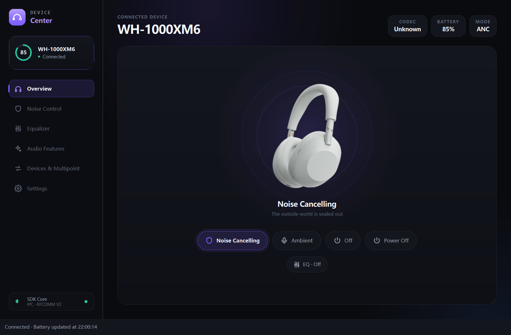
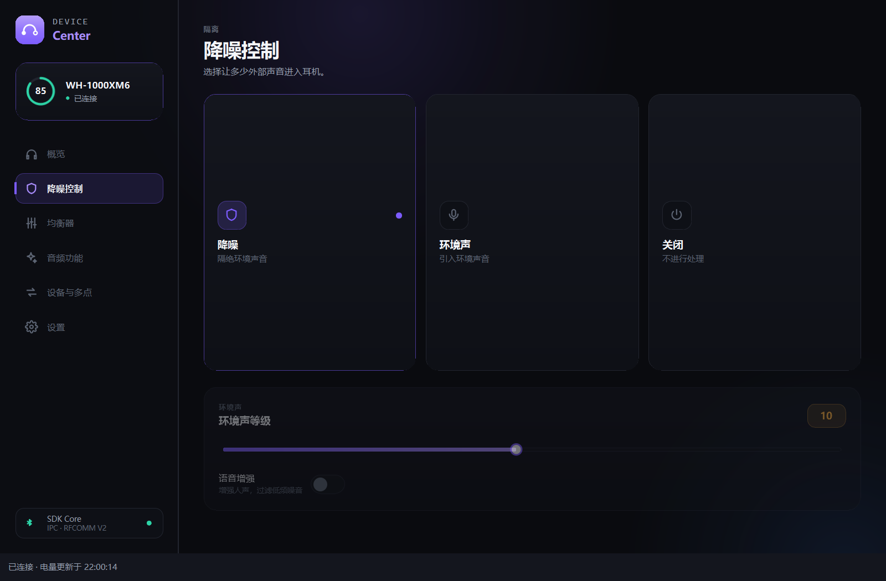
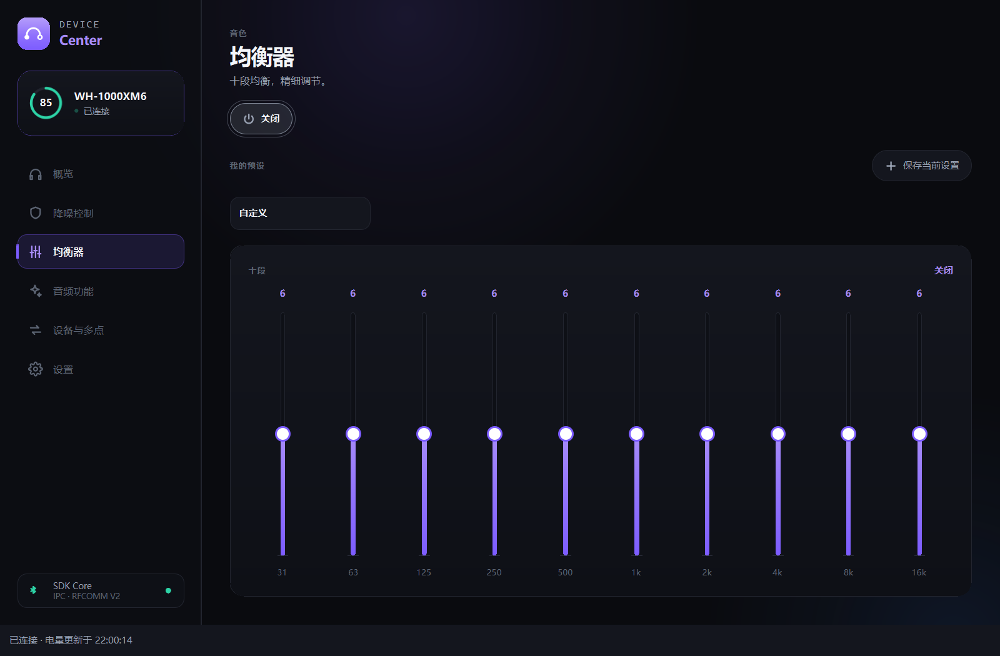
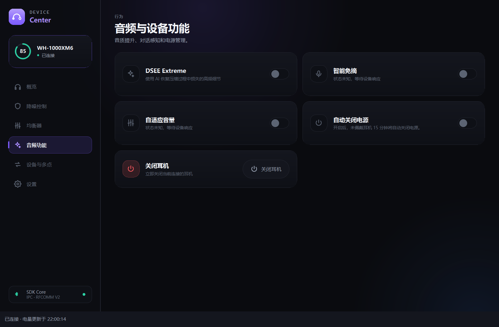
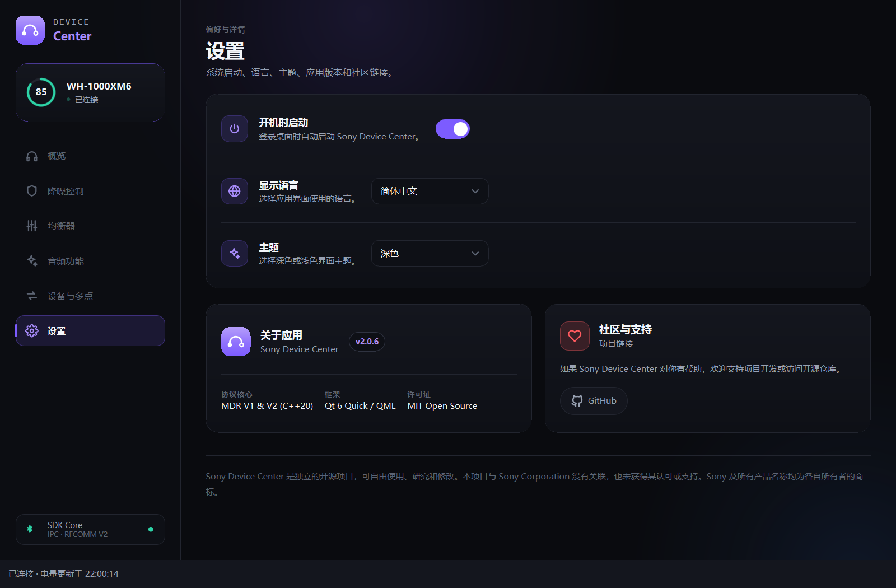

# Sony Device Center

**Check your Sony headphones' battery, switch noise control, and adjust the equalizer from your Windows desktop.**

Sony Device Center is an independent open-source project with a Qt 6 / QML desktop app, the `sonyctl` CLI, the `sonyd` daemon, and reusable C++20 Bluetooth and protocol libraries. No Sony account is required.

[Download 2.0.6 development preview](https://github.com/BEFUN-1/Sound-Connect-Center/releases/tag/v2.0.6-dev) · [中文](README.md) · [Getting started](docs/getting-started.md) · [Documentation](docs/README.md)



> The current download is a **Windows x64, unsigned Development prerelease: 2.0.6-dev**, dated November 2, 2026. Features and compatibility remain under development. Screenshots use simulated headphones and isolated settings; they contain no real Bluetooth addresses, paired-device names, accounts, or desktop content. They do not establish hardware compatibility.

## Features

| Feature | Scope |
| --- | --- |
| Battery and status | Headphone battery, connection state and device-reported information; battery display in the system tray |
| Noise control | Noise cancelling, ambient sound and off modes, with parameters based on device capabilities |
| Equalizer | Device presets, custom settings and saved local presets, including the WH-1000XM6 ten-band implementation |
| Audio and power | Capability-dependent DSEE, Speak-to-Chat, automatic power-off and headphone shutdown |
| Devices and multipoint | Target headset selection and supported multipoint operations |
| Preferences | Light/dark themes, multiple languages, startup preferences and tray controls |
| Developer tools | CLI, daemon and layered libraries; fake transport for tests without hardware |

Availability depends on the model, firmware and operating system. Unknown or unsupported states are shown explicitly. An implemented protocol command does not establish support on every device.

## Interface

| Noise control | Equalizer |
| --- | --- |
|  |  |

| Audio and device features | Settings |
| --- | --- |
|  |  |

See [screenshot provenance and capture instructions](docs/screenshots/README.md).

## Download and run

1. Open the [2.0.6-dev Release](https://github.com/BEFUN-1/Sound-Connect-Center/releases/tag/v2.0.6-dev) and download `SonyDeviceCenter-Qt2-2.0.6-dev-Setup.exe`.
2. Pair and connect your headset in Windows Bluetooth settings. Exit an older running version through its tray menu before upgrading.
3. Run the installer as a normal user. It installs into a fixed per-user directory, requires no administrator privileges and rejects custom `/D` paths.
4. Open the app and select your headset on the devices page. It remembers that target and does not fall back to another headset when the target is unavailable.
5. Closing the window leaves the app in the tray. Use the tray menu to quit.

The installer bundles Qt and the compiler runtime; no separate Qt or .NET installation is needed. This development package has no Authenticode signature. Check the prerelease label, filename and SHA-256; do not disable system security protections.

```powershell
Get-FileHash .\SonyDeviceCenter-Qt2-2.0.6-dev-Setup.exe -Algorithm SHA256
```

SHA-256 of this installer:

```text
3bec4c740a809c213fde22e50bce2365e35687310a10ee88e287aaece976973a
```

This release provides the Windows installer only. Linux and macOS source and packaging support remain available, with current-version native acceptance still pending.

## Changes and validation

Version 2.0.6 focuses on Windows connection ownership and status synchronization:

- Automatic recovery waits when Windows reports the selected headset disconnected or its state unknown.
- Control can resume when the same headset reconnects to Windows. A manual disconnect remains paused while the original system connection is unchanged.
- Fixes cover an incorrect permanent startup pause, migration of older pause records and address casing that prevented the UI from updating.
- Battery scheduling, worker threads, image decoding and Qt payload optimizations from 2.0.5 are retained.

The delivery record reports 202 registered CTest checks: 201 passed and one Unix socket check skipped on Windows; 27 Qt controller checks and nine simulated page/tray lifecycle checks passed. Limited physical WH-1000XM6 checks covered battery reads, nine confirmed noise-mode changes, manual control disconnect/recovery and battery updates while the window was hidden.

This round did not complete physical system disconnect/reconnect, physical buttons, a full power cycle, phone calls and multipoint audio switching, or clean Windows VM installation/upgrade/uninstall. The 2.0.5 two-hour resource run is historical evidence, not a new 2.0.6 result.

See the [release notes](docs/releases/v2.0.6-dev.md), [2.0.6 acceptance record](docs/acceptance-2.0.6-2026-11-02.md) and [compatibility matrix](docs/device-matrix.md).

## Build from source

Requirements: a C++20 compiler, CMake 3.14+, Qt 6 with Quick/QML/Quick Controls 2, and platform Bluetooth development dependencies. With testing enabled, CMake finds Catch2 3 or downloads the pinned fallback.

```bash
cmake -S . -B build -DCMAKE_BUILD_TYPE=Release -DBUILD_TESTING=ON \
  -DSONY_REQUIRE_QT=ON -DCMAKE_PREFIX_PATH=/path/to/Qt
cmake --build build --parallel
ctest --test-dir build --output-on-failure --no-tests=error
```

For Windows multi-configuration generators, add `--config Release` to the build and `-C Release` to CTest. Use matching compiler and Qt toolchains. See [platform dependencies, packaging and signing](packaging/README.md).

Common targets are `sony-device-center`, `sonyctl` and `sonyd`:

```bash
sonyctl --help
sonyctl --direct devices
sonyctl --direct --device AA:BB:CC:DD:EE:FF info
sonyd --simulated
```

The address is a placeholder. Close competing clients before opening a direct Bluetooth session. Unix socket IPC is unavailable on Windows; the desktop app connects directly and the CLI requires `--direct`.

## Source layout

| Path | Purpose |
| --- | --- |
| `apps/device-center/` | Qt desktop UI and controller |
| `apps/sonyctl/`, `apps/sonyd/` | CLI and background service |
| `libs/sony-transport/` | Bluetooth discovery, transport and fake implementations |
| `libs/sony-protocol/` | Frames, protocol commands and device capabilities |
| `libs/sony-core/` | Device service, state, recovery policy and IPC |
| `tests/` | Protocol, core, UI and packaging checks |
| `docs/`, `packaging/` | Guides, validation records and platform packaging |

Further reading: [architecture](docs/architecture-current.md), [connection and IPC](docs/ipc-and-lifecycle.md), [known issues](docs/technical-debt.md), [contributing](CONTRIBUTING.md) and the [documentation index](docs/README.md).

For issues, include the model, firmware if available, OS version, reproduction steps and error message. Remove Bluetooth addresses, computer/phone names, usernames, local paths and credentials from screenshots and logs.

## Disclaimer and license

This project is not affiliated with, authorized by or partnered with Sony. It uses a reverse-engineered protocol for interoperability research. Sony and related product names belong to their respective owners.

Released under the [MIT License](LICENSE). Third-party components retain their own licenses.
