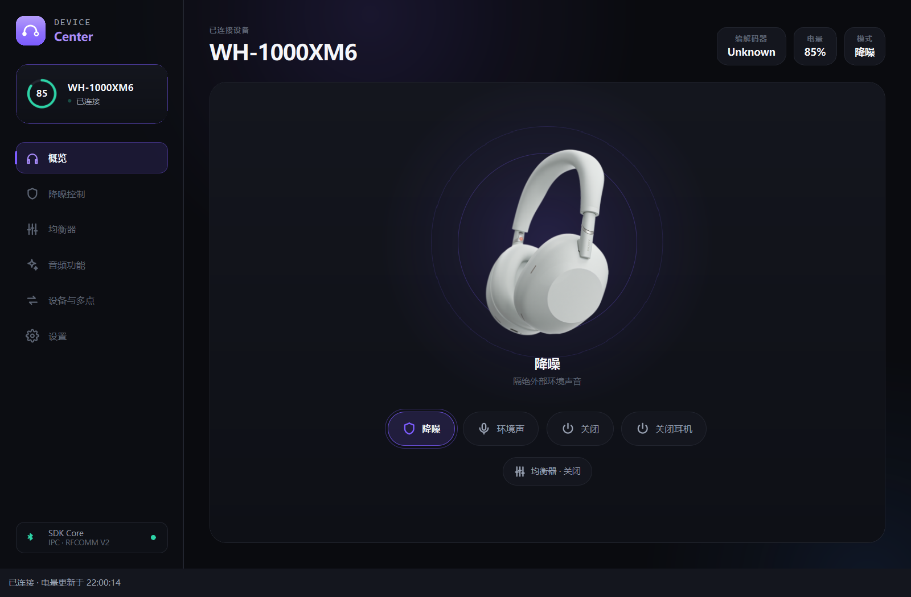
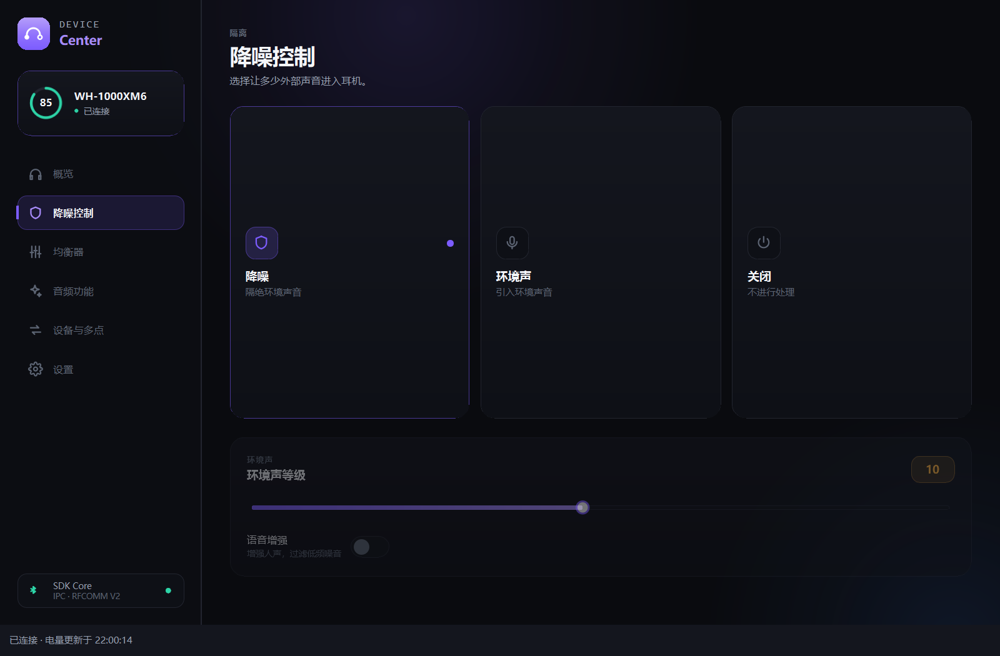
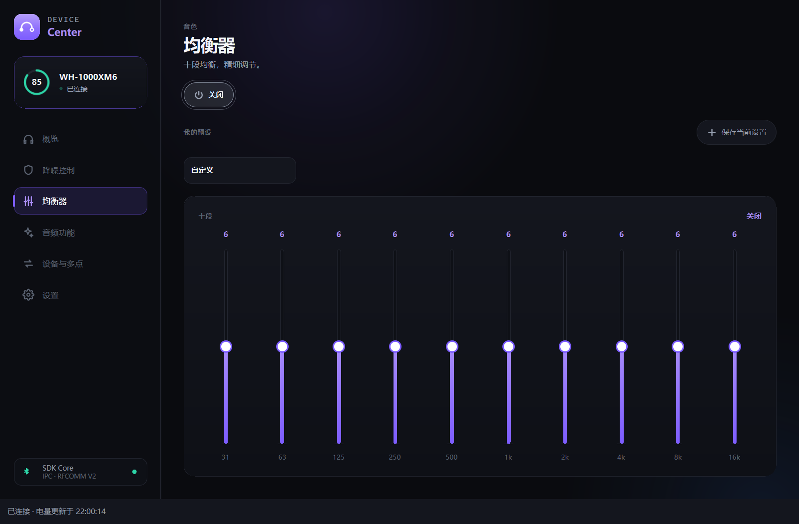
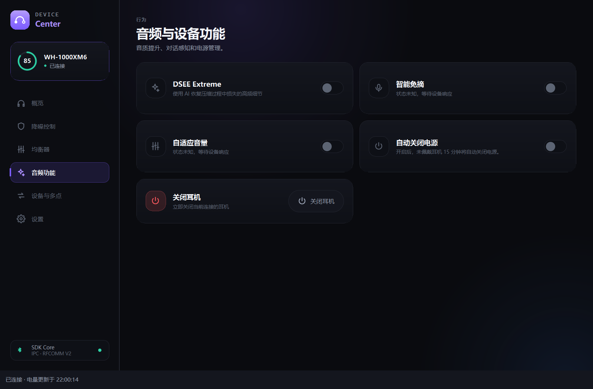
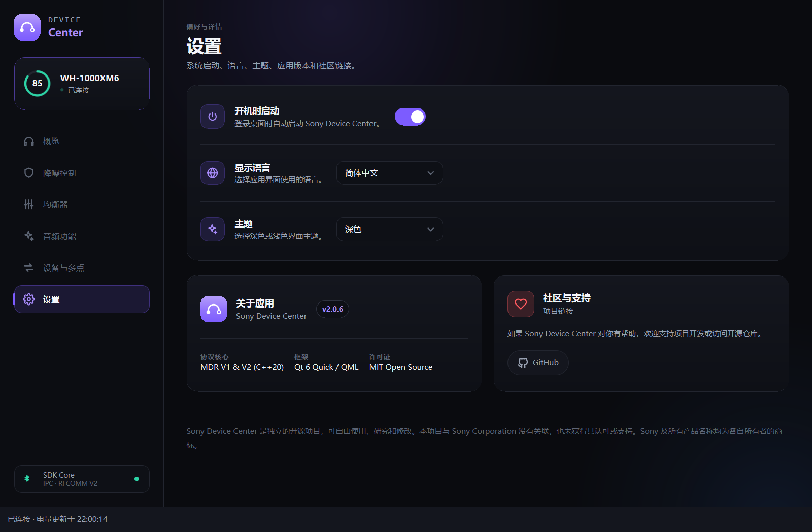

# Sony Device Center

**在 Windows 桌面查看索尼耳机电量、切换降噪与环境音、调整均衡器。**

Sony Device Center 是一个独立的开源耳机控制项目，提供 Qt 6 / QML 桌面界面、`sonyctl` 命令行工具、`sonyd` 后台服务，以及可复用的 C++20 蓝牙与协议库。无需登录 Sony 账号。

[下载 2.0.6 正式版](https://github.com/BEFUN-1/Sound-Connect-Center/releases/tag/v2.0.6) · [English](README.en.md) · [使用指南](docs/getting-started.md) · [文档导航](docs/README.md)



> 当前下载为 **Windows x64 / 2.0.6 正式版**，发布日期为 2026-11-02。维护者已验证本次安装文件并确认正式发布；安装包尚未进行 Authenticode 签名。界面截图使用模拟耳机和隔离设置生成，不包含真实蓝牙地址、配对设备名称、账户或桌面内容；截图不代表所有功能都经过真机验证。

## 可以做什么

| 功能 | 说明 |
| --- | --- |
| 电量与状态 | 查看耳机电量、连接状态及设备返回的信息；托盘显示电量，关闭窗口后仍可驻留 |
| 降噪与环境音 | 切换降噪、环境音、正常模式；可用参数取决于耳机能力 |
| 均衡器 | 设备预设、自定义参数及本地预设管理；包含 WH-1000XM6 的十段均衡器实现 |
| 音频与电源 | 按设备能力提供 DSEE、智能免摘、自动关闭电源和关机控制 |
| 设备与多点 | 选择目标耳机，查看与操作设备支持的多点连接功能 |
| 个性化 | 深浅主题、多语言、开机启动和托盘快捷控制 |
| 开发与自动化 | 使用 CLI、后台服务和分层 C++ 库；模拟传输可在无耳机时运行测试 |

功能会受型号、固件和系统影响。界面中的未知、未支持或等待响应状态应按实际含义理解；协议已实现不等于所有设备都可用。

## 界面预览

| 降噪控制 | 均衡器 |
| --- | --- |
|  |  |

| 音频与设备功能 | 设置 |
| --- | --- |
|  |  |

截图来源与重新生成方法见 [截图说明](docs/screenshots/README.md)。

## 下载与开始使用

1. 打开 [2.0.6 Release](https://github.com/BEFUN-1/Sound-Connect-Center/releases/tag/v2.0.6)，下载 `SonyDeviceCenter-Qt2-2.0.6-Setup.exe`。
2. 在 Windows 蓝牙设置中先配对并连接耳机。升级前从托盘菜单退出旧版程序。
3. 以普通用户身份运行安装器。安装器使用固定的当前用户目录，不需要管理员权限，不接受自定义 `/D` 安装位置。
4. 启动 Sony Device Center，在“设备与多点”页面选择耳机。之后保存目标耳机，不会因为目标不可用就自动连接另一副。
5. 关闭窗口会收起到托盘；完全退出请使用托盘菜单。

安装包已包含 Qt 与编译器运行库，无需另装 Qt 或 .NET。包未进行 Authenticode 签名；请核对发布页的文件名和 SHA-256，不要为运行本项目关闭系统安全保护。

```powershell
Get-FileHash .\SonyDeviceCenter-Qt2-2.0.6-Setup.exe -Algorithm SHA256
```

本次指定安装包的 SHA-256：

```text
3bec4c740a809c213fde22e50bce2365e35687310a10ee88e287aaece976973a
```

详细步骤和常见问题见 [使用指南](docs/getting-started.md)。本次 Release 仅提供 Windows 安装包；Linux 与 macOS 保留源码和打包支持，当前版本仍需对应平台验收。

## 2.0.6 更新与验证范围

2.0.6 重点修复 Windows 连接跟随与状态同步：

- Windows 未连接耳机或连接状态未知时，自动恢复不会主动建立控制连接。
- 同一耳机重新连接 Windows 后，程序可跟随恢复控制；手动断开在当前系统连接未变化时保持暂停。
- 修复启动时误记永久暂停、旧暂停记录迁移，以及地址大小写导致页面连接状态不更新的问题。
- 沿用 2.0.5 的电量同步、后台线程、图片与 Qt 载荷优化。

交付时记录：CTest 202 项注册，201 项通过、1 项 Windows 不支持的 Unix socket 检查跳过；Qt 控制器 27 项通过，页面与托盘生命周期模拟 9 项通过。WH-1000XM6 完成电量读取、9 次模式切换读回、软件断开与恢复、隐藏窗口电量更新等有限真机验证。

真实系统断开／重连、实体按键、完整关机／开机、手机通话与多点音频切换，以及干净 Windows 虚拟机安装／升级／卸载尚未完成本轮完整验收。2.0.5 的两小时资源记录不作为 2.0.6 的新测试结果。

查看 [发布说明](docs/releases/v2.0.6.md)、[2.0.6 验收记录](docs/acceptance-2.0.6-2026-11-02.md) 和 [设备验证矩阵](docs/device-matrix.md)。

## 从源码构建

需要 C++20 编译器、CMake 3.14+、Qt 6（包含 Quick、QML、Quick Controls 2）和系统蓝牙开发依赖。启用测试时，CMake 会查找 Catch2 3，未找到则下载固定版本。

```bash
cmake -S . -B build -DCMAKE_BUILD_TYPE=Release -DBUILD_TESTING=ON \
  -DSONY_REQUIRE_QT=ON -DCMAKE_PREFIX_PATH=/path/to/Qt
cmake --build build --parallel
ctest --test-dir build --output-on-failure --no-tests=error
```

Windows 多配置生成器请为构建添加 `--config Release`、为 CTest 添加 `-C Release`。Qt 与编译器必须使用匹配的工具链。平台依赖、安装器与签名流程见 [构建和打包说明](packaging/README.md)。

常用程序为 `sony-device-center`、`sonyctl`、`sonyd`。CLI 示例：

```bash
sonyctl --help
sonyctl --direct devices
sonyctl --direct --device AA:BB:CC:DD:EE:FF info
sonyd --simulated
```

示例地址是占位符。直接连接前先退出占用同一耳机的程序；Windows 暂不支持 Unix socket IPC，桌面程序使用直接连接，CLI 使用 `--direct`。

## 项目结构与文档

| 路径 | 内容 |
| --- | --- |
| `apps/device-center/` | Qt 桌面界面与控制器 |
| `apps/sonyctl/`、`apps/sonyd/` | 命令行与后台服务 |
| `libs/sony-transport/` | 蓝牙传输、发现与模拟实现 |
| `libs/sony-protocol/` | 帧编码、协议与设备能力 |
| `libs/sony-core/` | 设备服务、状态、恢复策略与 IPC |
| `tests/` | 协议、核心、界面和打包检查 |
| `docs/`、`packaging/` | 使用说明、验证记录与平台打包 |

更多内容：[架构](docs/architecture-current.md) · [连接与 IPC](docs/ipc-and-lifecycle.md) · [已知问题](docs/technical-debt.md) · [贡献指南](CONTRIBUTING.md) · [完整文档](docs/README.md)。

报告问题时请提供型号、可查询到的固件、Windows／系统版本、操作步骤与错误信息。提交截图和日志前，请移除真实蓝牙地址、电脑与手机名称、用户名、本地路径和凭据。

## 声明与许可证

本项目与 Sony 没有隶属、授权或合作关系，使用逆向分析的协议进行互操作性研究。Sony 及相关产品名称归其各自所有者所有。

使用 [MIT 许可证](LICENSE)；第三方组件保留各自的许可。
