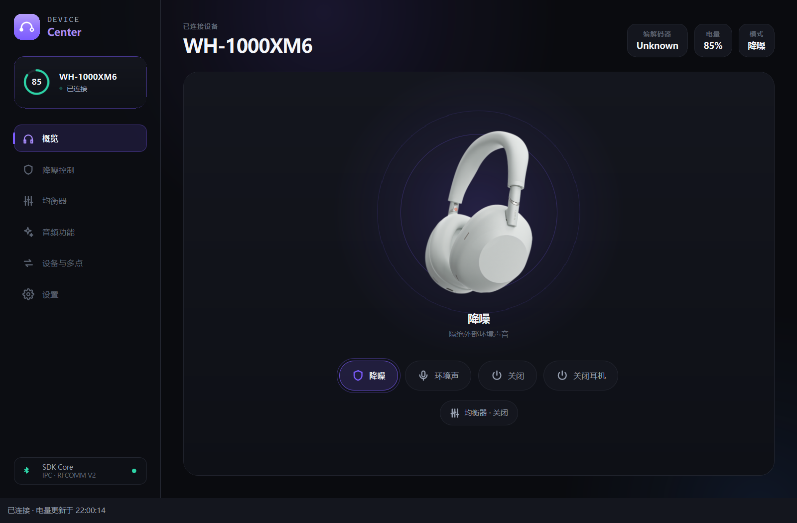
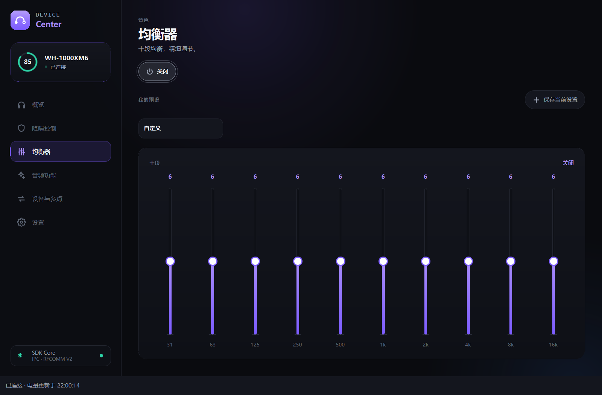

# Sony Device Center 2.0.6-dev

2026-11-02 · Windows x64 · **历史 Development 预发布 / 未签名**

> 同一安装文件已由维护者验证并批准作为 [2.0.6 正式版](https://github.com/BEFUN-1/Sound-Connect-Center/releases/tag/v2.0.6) 发布。此页保留原预发布记录。

[下载与附件](https://github.com/BEFUN-1/Sound-Connect-Center/releases/tag/v2.0.6-dev) · [中文介绍](https://github.com/BEFUN-1/Sound-Connect-Center/blob/main/README.md) · [English](https://github.com/BEFUN-1/Sound-Connect-Center/blob/main/README.en.md)

Sony Device Center 让你在桌面查看索尼耳机电量，切换降噪和环境音，调整均衡器，
并使用托盘快捷控制。当前桌面使用 Qt 6 / QML，同时保留 CLI、daemon 和 C++20 库。
本项目独立于 Sony，兼容性依型号、固件及操作系统而异。

## 界面

以下为 2.0.6 真实 QML 界面，使用模拟 WH-1000XM6 和隔离设置生成，
不含真实蓝牙地址、账户、配对设备名称或桌面内容，不作为真机兼容性证明。





## 更新内容

- 桌面发布目标从旧 Windows Forms 1.3 迁移至 Qt 2.x。
- 2.0.6 自动恢复跟随 Windows 对已选择耳机的连接状态；系统未连接或未知时等待。
- 软件主动断开在当前系统连接未变化时保持暂停，观察到系统断开后可在重新连接时恢复。
- 修复初始未连接误记永久暂停、旧暂停记录迁移及设备地址大小写造成的页面状态滞后。
- 保留 2.0.5 的电量调度、后台线程、图片解码、动画与 Qt 载荷优化。
- 更新中英文介绍、安装指南、验证范围、文档导航与模拟界面截图。

## 安装

下载附件 `SonyDeviceCenter-Qt2-2.0.6-dev-Setup.exe`。先在 Windows 蓝牙设置中
配对并连接耳机；升级前从托盘退出旧程序，然后以普通用户身份运行安装器。
安装器使用固定的当前用户目录，不需要管理员权限，不接受自定义 `/D` 路径。
启动后在设备页面选择耳机。关闭窗口保留托盘进程，完全退出请使用托盘菜单。
Qt 与编译器运行库已打包，无需安装 .NET。

本文件为维护者指定的既有 **未签名开发包**，保留原文件名和内容。
如系统阻止运行，请先核实来源和校验和，不要关闭安全保护。

| 文件 | 大小 | SHA-256 |
| --- | --- | --- |
| `SonyDeviceCenter-Qt2-2.0.6-dev-Setup.exe` | 55,815,416 bytes | `3bec4c740a809c213fde22e50bce2365e35687310a10ee88e287aaece976973a` |

```powershell
Get-FileHash .\SonyDeviceCenter-Qt2-2.0.6-dev-Setup.exe -Algorithm SHA256
```

## 验证范围

交付记录：CTest 注册 202 项，201 项通过、1 项 Unix socket 检查在 Windows 跳过；
Qt 控制器 27 项通过；页面、托盘及生命周期模拟 9 项通过；发布安全检查 9 项通过。
载荷通过软件、默认及 OpenGL 渲染启动检查，便携 ZIP 与安装载荷文件哈希一致。

本轮有限 WH-1000XM6 真机验证覆盖电量读取、9 次模式切换并独立查询确认、
软件主动断开与手动恢复、隐藏窗口电量更新。固件查询为空，不推测版本。

尚未完成本轮完整验收：真实系统断开／重连、实体按键、完整关机／开机、
手机通话与多点音频切换、干净 Windows 虚拟机安装／升级／卸载。
2.0.5 两小时资源长测仅作历史依据；不宣称 2.0.6 新长测或续航提升百分比。
Linux/macOS 本次没有下载附件，当前版本仍需原生验收。

## 来源与限制

应用源码与交付源码指纹核对一致。安装器来自交付时的未提交开发工作区，
没有为了此次发布重新构建或签名；本次 tag 标记整理后的源码快照，不能视为
原安装包来自干净 tag 构建的证明。文档与截图生成辅助函数为发布整理时补充。
附件中的来源记录和 `SHA256SUMS.txt` 保留此区别。

Windows 暂不支持 Unix socket IPC，桌面程序直接连接耳机；CLI 请使用 `--direct`，
并避免其他客户端同时占用同一耳机。协议实现和模拟通过不代表所有型号真机通过。

详细记录见仓库的 `docs/acceptance-2.0.6-2026-11-02.md`、
`docs/reconnect-follow-system-2.0.6-2026-11-02.md` 和 `docs/device-matrix.md`。

## English

This is the **unsigned Windows x64 2.0.6-dev prerelease** of Sony Device Center,
an independent Qt 6 desktop companion for Sony headphones. It includes the
maintainer-selected existing installer, unchanged, with checksums and provenance.
It is not a signed production build or a clean-tag rebuild.

Version 2.0.6 fixes Windows-following control recovery, persisted manual pauses,
startup pause migration and address-casing UI updates. Limited WH-1000XM6 checks
covered battery, confirmed noise-mode changes and manual control recovery.
Physical reconnect/power cycles, phone calls, multipoint audio routing and clean
VM installation remain incomplete. Other models and native Linux/macOS builds
need further validation. Screenshots use synthetic devices and isolated settings.

Pair and connect in Windows first, quit the old tray app, then run the installer
as a normal user. Select your headset in the app. No separate Qt/.NET installation
is required. Check SHA-256 before running; do not disable system protections.
