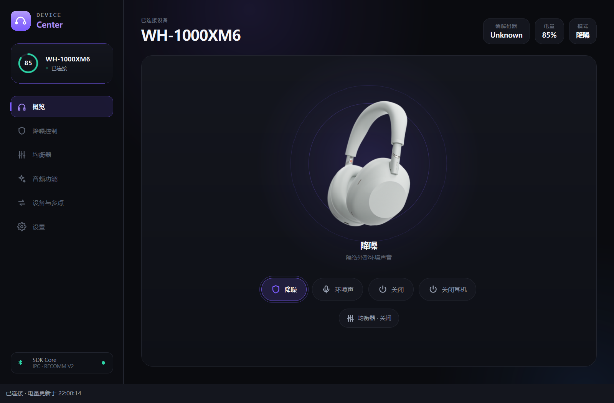
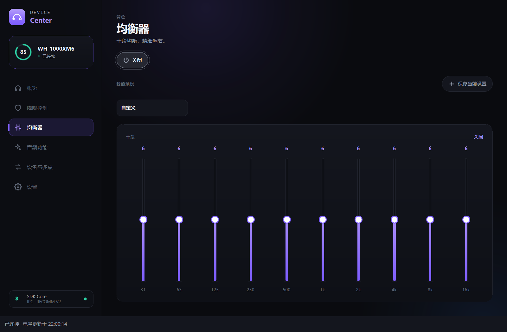

# Sony Device Center 2.0.6

2026-11-02 · **正式版 / Stable release** · Windows x64

[下载与附件](https://github.com/BEFUN-1/Sound-Connect-Center/releases/tag/v2.0.6) · [中文介绍](https://github.com/BEFUN-1/Sound-Connect-Center/blob/main/README.md) · [English](https://github.com/BEFUN-1/Sound-Connect-Center/blob/main/README.en.md)

**维护者已验证本次安装文件，并确认作为 2.0.6 正式版发布。**
本次使用维护者指定的既有安装包，文件内容与此前预发布完全一致。

Sony Device Center 是独立的开源索尼耳机桌面控制项目，提供 Qt 6 / QML 界面、
电量与托盘显示、降噪和环境音控制、均衡器，以及按设备能力提供的音频与电源功能。
项目还包含 `sonyctl`、`sonyd` 和可复用的 C++20 库。

## 下载与安装

下载 **`SonyDeviceCenter-Qt2-2.0.6-Setup.exe`**。

1. 在 Windows 蓝牙设置中配对并连接耳机。
2. 升级前从托盘菜单退出旧版 Sony Device Center。
3. 以普通用户身份运行安装器；不需要管理员权限，不接受自定义 `/D` 安装路径。
4. 启动后在设备页面选择耳机。关闭窗口会收起到托盘，完全退出请使用托盘菜单。

Qt 和编译器运行库已包含，无需另装 Qt 或 .NET。

| 文件 | 大小 | SHA-256 |
| --- | --- | --- |
| `SonyDeviceCenter-Qt2-2.0.6-Setup.exe` | 55,815,416 bytes | `3bec4c740a809c213fde22e50bce2365e35687310a10ee88e287aaece976973a` |

```powershell
Get-FileHash .\SonyDeviceCenter-Qt2-2.0.6-Setup.exe -Algorithm SHA256
```

正式版下载文件名已去掉 `-dev`，原始文件名为
`SonyDeviceCenter-Qt2-2.0.6-dev-Setup.exe`。二者字节内容和 SHA-256 完全相同；
本次没有重新编译、修改或签名安装包。**安装包尚未进行 Authenticode 签名**，
请按发布页校验文件来源和哈希。

## 本版更新

- Qt 2.x 桌面界面，包含概览、降噪、均衡器、音频功能、设备与多点和设置页面。
- Windows 自动恢复跟随已选择耳机的系统连接状态；系统未连接或状态未知时等待。
- 软件主动断开后，在当前系统连接未变化时保持暂停；观察到系统断开后可在同一耳机重新连接时恢复。
- 修复启动时误记永久暂停、旧暂停记录迁移，以及地址大小写造成页面状态不更新的问题。
- 沿用 2.0.5 的电量调度、后台线程、图片解码、动画与 Qt 载荷优化。
- 更新中英文说明、安装指南和经过隐私检查的界面截图。

## 界面预览

截图来自真实 QML 界面，使用模拟 WH-1000XM6 和隔离设置生成，
不包含真实蓝牙地址、账户、配对设备名称或桌面内容。





## 验证与来源

维护者于 2026-11-02 确认本安装文件已验证，并明确批准正式发布。
此确认记录不补写未提供的逐项测试场景，也不改变原自动化结果。

既有交付记录：CTest 注册 202 项，201 项通过、1 项 Unix socket 检查在 Windows 跳过；
Qt 控制器 27 项通过，页面与托盘生命周期模拟 9 项通过。
有限 WH-1000XM6 真机记录覆盖电量读取、9 次模式切换并独立查询确认、
软件主动断开和恢复，以及隐藏窗口电量更新。

应用源码与原交付源码清单核对一致。安装包最初来自未提交的开发工作区；
正式发布 tag 标记当前源码与说明，并不表示原包由干净 tag 重新构建。
原始构建清单中的 Development 标识、`dirty_worktree` 和签名状态如实保留，
另附正式发布来源记录和 `SHA256SUMS.txt`。

## 兼容性

功能可用性受耳机型号、固件、操作系统和蓝牙适配器影响，请查看设备验证矩阵。
Windows 桌面程序直接连接耳机；CLI 使用 `--direct`，避免多个控制客户端同时占用。
本次只提供 Windows x64 安装器，Linux/macOS 保留源码与打包支持。
原交付记录中未逐项完成的真机和干净虚拟机验收范围继续保留在版本化文档中。

本项目与 Sony 没有隶属、授权或合作关系，使用 MIT 许可证。

## English

**Sony Device Center 2.0.6 is a stable Windows x64 release.** The maintainer has
verified and explicitly approved the exact existing installer for publication.

Download `SonyDeviceCenter-Qt2-2.0.6-Setup.exe`. Its filename omits `-dev`, while
its bytes and SHA-256 remain identical to the original
`SonyDeviceCenter-Qt2-2.0.6-dev-Setup.exe`. It was not rebuilt or modified for
publication and has no Authenticode signature. Original development-build
provenance remains disclosed in the attached manifests.

Pair and connect in Windows, quit the old tray app, then run the installer as a
normal user. Qt and compiler runtimes are bundled; no separate .NET is required.
This version fixes Windows-following recovery, persisted pauses and address-case
UI synchronization. Features depend on device capabilities. Screenshots use
synthetic devices and isolated settings.
