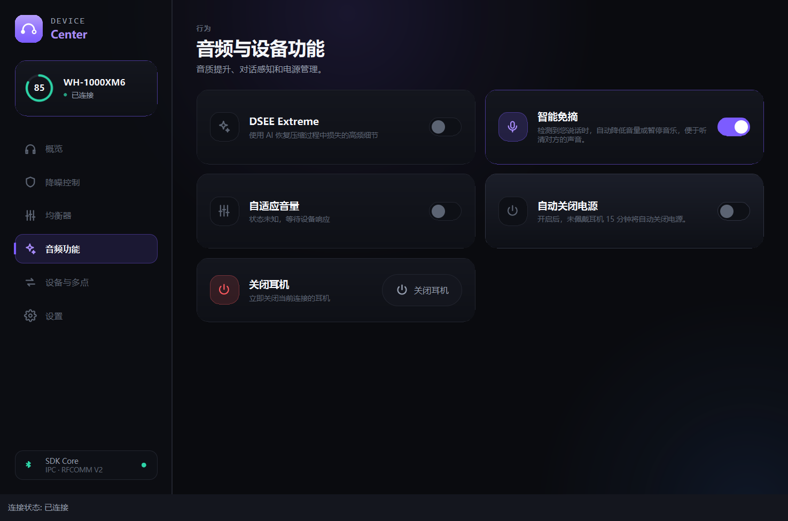

# 界面术语依据

核对日期：2026-11-01。以下来源为 Sony 中国官方产品页及
WH-1000XM6 简体中文帮助指南。

| 界面位置 | 文案 | 说明 |
| --- | --- | --- |
| 功能标题 | 智能免摘 | Sony 中国 WH-1000XM4 产品页使用“智能免摘对话”；采用用户指定的简短名称，对应 Speak-to-Chat，英文界面保留原名 |
| 功能说明 | 检测到您说话时，自动降低音量或暂停音乐，便于听清对方的声音。 | XM6 指南描述降低音乐音量、通过麦克风拾取对方声音；界面不再保证所有型号都会暂停播放 |
| 电源设置标题 | 自动关闭电源 | 与指南中的“佩戴检测自动关闭电源功能”一致 |
| 仅支持佩戴检测的电源设置说明 | 开启后，未佩戴耳机 15 分钟将自动关闭电源。 | 依据 XM6 指南的 15 分钟未佩戴条件；不再使用模糊的“一段时间未使用” |
| 其他电源设置说明 | 选择耳机支持的自动关闭电源条件。 | 选项仍取自实际设备能力，避免把佩戴检测与普通空闲定时混为一谈 |

“智能免摘（Speak-to-Chat）”是功能开关，自动对话模式何时启动和结束由耳机检测控制。
它不等于应用程序在 PC 上执行“暂停播放”，也不是固定的环境声模式切换按钮。
界面继续保留原有的大标题、小字说明和未知状态提示。

官方来源：

- [Sony 中国 WH-1000XM4 产品页：智能免摘对话](https://www.sonystyle.com.cn/products/headphone/wh_1000xm4/wh_1000xm4_b.html)
- [戴上耳机时与人说话（Speak-to-Chat）](https://helpguide.sony.net/mdr/2984/v1/zh-cn/contents/TP1001860100.html)
- [关闭耳机](https://helpguide.sony.net/mdr/2984/v1/zh-cn/contents/TP1001856694.html)
- [Sony | Sound Connect 应用程序的功能说明](https://helpguide.sony.net/mdr/2984/v1/zh-cn/contents/TP1001856577.html)

对应实现位于 `apps/device-center/src/I18nManager.cpp` 和
`apps/device-center/qml/Main.qml`；Qt 测试同时检查翻译值与实际 QML 文本。

下图来自模拟 WH-1000XM6 的原生 Qt 测试，未向真实耳机发送写命令：

